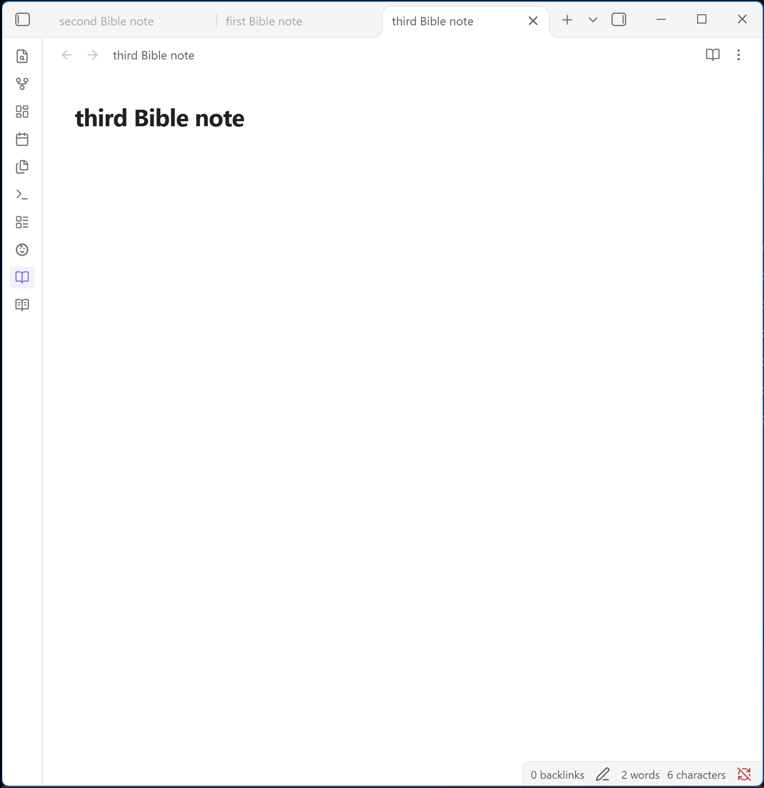
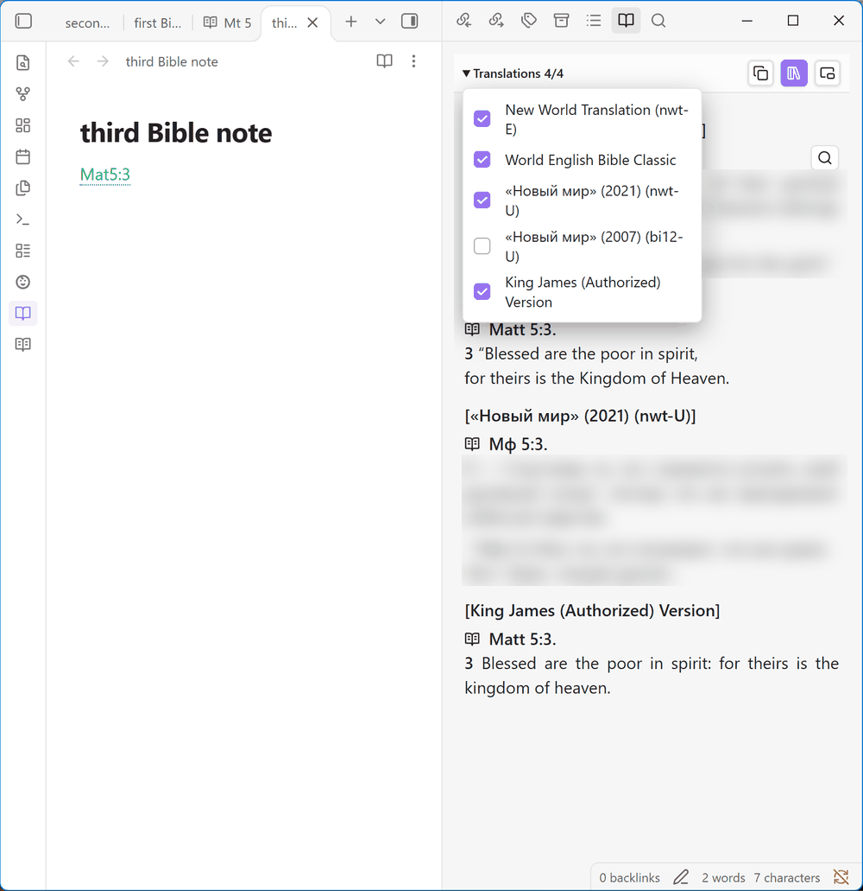
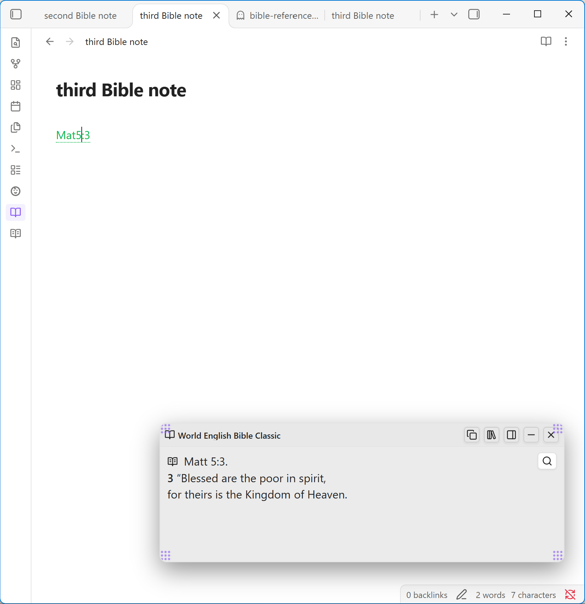
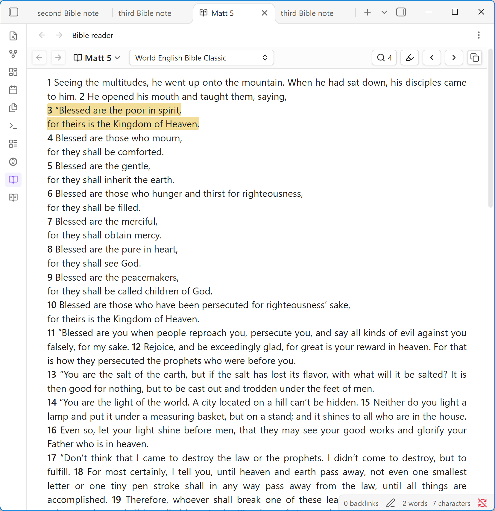
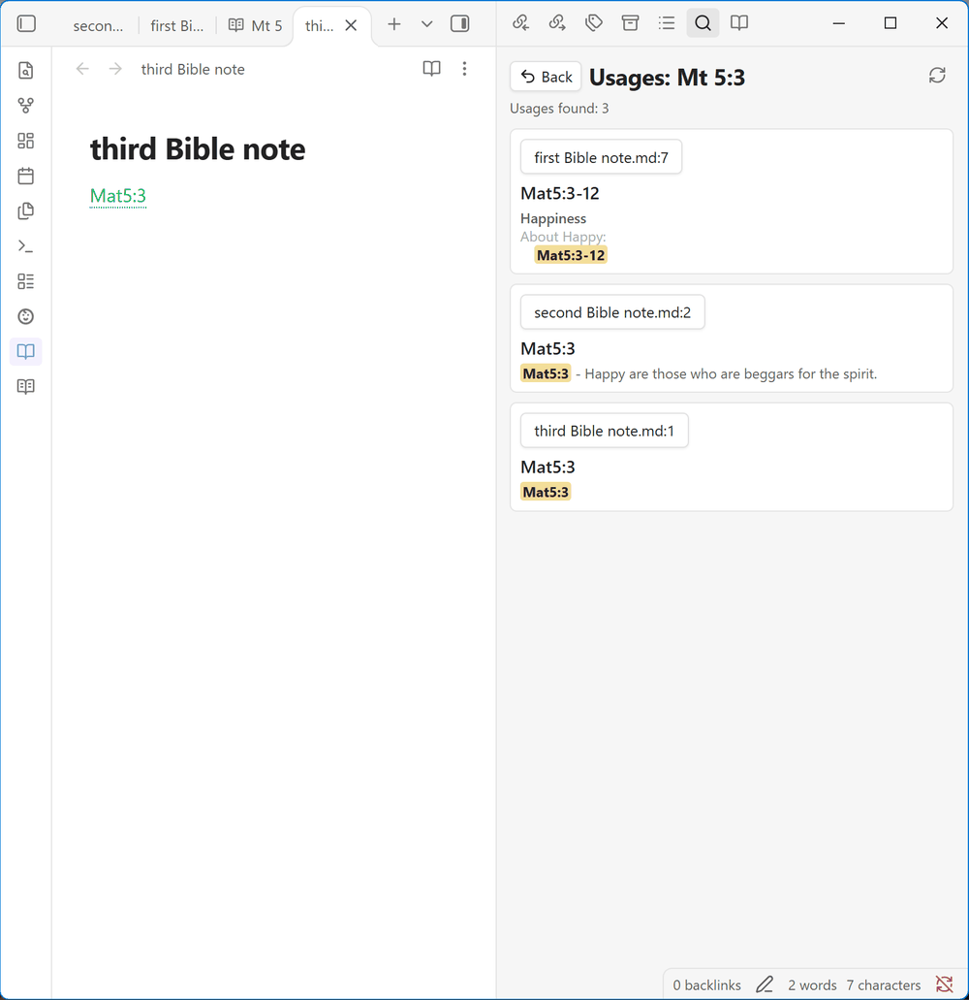
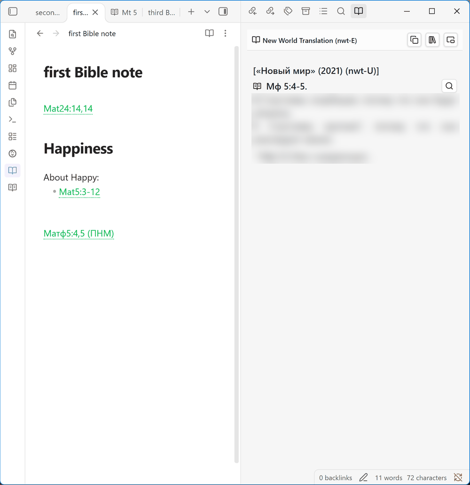
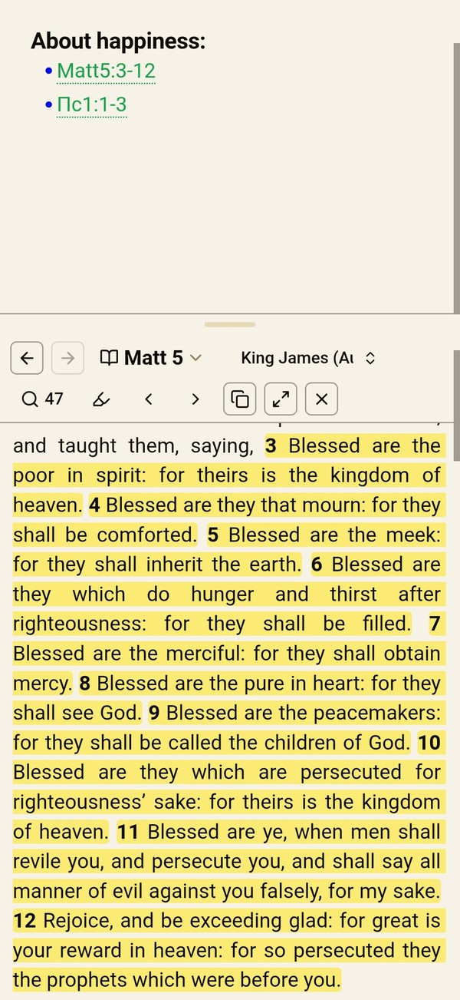
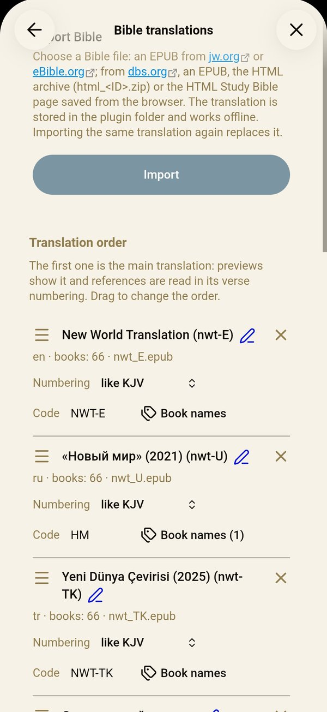

# Bible Reference Preview

**English** | [Русский](README.ru.md)

[](https://boosty.to/yuriybak)

Write `John 3:16` in a note and read the verse right next to it, in a floating window or in a side panel. Works offline on desktop and on phones (Android, iOS), with Bible translations you import once from free EPUB and HTML files, in any language they are published in.



## Why this plugin

- **Works with the notes you already have.** Open any note and every Bible reference in it is highlighted as a link, with no special syntax, code blocks or tags to add. The references get a dotted underline and a color of your choice, so they stand apart from ordinary links.
- **Works offline.** Translations are stored locally on your device; the plugin makes no network requests.
- **Your translations.** Import Bibles from jw.org, eBible.org (hundreds of translations in many languages) and the Digital Bible Society (dbs.org).
- **Compare up to four translations** side by side. Verse numbering is converted between translations: the Synodal Psalm 22 is shown as Psalm 23 in an English Bible.
- **Bible reader:** open any book and chapter, even without a reference in a note, and read it in any imported translation without changing the default one. Cited verses are highlighted.
- **Find where a passage is quoted** across all your notes, with a short context for each usage.
- **Desktop and mobile:** Windows, macOS, Linux, Android and iOS. Russian and English interface.

## What's new in 0.3.6

- **Clean plugin check:** the styles no longer use `display: contents` and `:has`, which Obsidian's plugin check warned about; the translation list looks and works as before.

From 0.3.5:

- **Insert Bible text into a note:** the command **Insert Bible text**, suggestions after `--` (`--John 3:16`) and **Insert into note** in the preview's menu; the text goes in as a foldable callout, a quote or a `bible` block.
- **`bible` code block:** write references in it, one per line, and the note shows their text in reading mode, Live Preview, PDF export and print.
- **Bible search:** the command **Search Bible text** or the magnifier in the reader finds verses by words or a phrase, in the whole Bible, a Testament or one book.
- **Shorter settings:** preview, inserting and suggestions, and appearance are pages of their own, each showing the current choice.
- **A reference no longer continues on the next line**, and the plugin can now be supported on [Boosty](https://boosty.to/yuriybak).

All changes, including beta versions in progress, are in the [changelog](CHANGELOG.md).

## Screenshots

<table>
<tr><td width="50%"><br><sub>Comparison of up to four translations in the side panel</sub></td><td width="50%"><br><sub>Floating window</sub></td></tr>
<tr><td width="50%"><br><sub>Chapter view with the cited verse highlighted</sub></td><td width="50%"><br><sub>Where a passage is quoted in your notes</sub></td></tr>
<tr><td width="50%"><br><sub>A translation code after a reference: (СП) shows a Russian translation</sub></td><td></td></tr>
<tr><td width="50%" align="center"><br><sub>On a phone: the Bible reader under the note</sub></td><td width="50%" align="center"><br><sub>On a phone: the Bible translations page</sub></td></tr>
</table>

## Quick start

1. Install **Bible Reference Preview** from Settings → Community plugins and enable it. A notice with an **Open settings** button shows where to start; until a translation is imported, the **Bible translations** page of the plugin settings lists where to download a Bible file.
2. Download a free Bible file (EPUB), for example the [World English Bible](https://ebible.org/epub/engwebp.epub) or the [King James Version](https://ebible.org/epub/eng-kjv2006.epub). Other translations and languages are on [ebible.org/find](https://ebible.org/find/); for Russian, the [Synodal translation](https://ebible.org/epub/russyn.epub).
3. Open Settings → Bible Reference Preview → **Bible translations**, click **Import**, choose the file and click **Import** again.
4. Type a reference such as `John 3:16` or `Rom 8:28-30` in any note. The preview opens for the paragraph under the cursor.

More sources and details are in [Importing a translation](#importing-a-translation).

## Features

- **References** are recognized in any note, new or old, in the editor and in reading view, and are shown as links: `John 3:16`, `Mark 4:12, 14-16`, `Jude 1:3;1:5`, `Judg 7:24-8:1`, one-chapter books (`Jude 5` = `Jude 1:5`). Book names and abbreviations come from the imported translations, so references work in the language of any of them (`Ин3:16` with a Russian Bible, `John 3:16` with an English one, both in one note). When two translations abbreviate different books the same way, the main translation wins; numbering follows the main translation unless a translation code is given. Add your own names and abbreviations of the books with **Book names** in a translation's row on the **Bible translations** page of the settings (`Jhn`, `Йн`): they are recognized like the translation's own, and a name another book of the translation already has cannot be added. Bible references have a dotted underline and are green by default, so they don't look like ordinary links; the color can be changed in the settings.
- **Preview** opens for the reference in the current paragraph, or only when you click a reference. The floating window can be dragged, resized and collapsed; the side panel can sit on the left or right. Both work in popout windows.
- **On a phone**, the side panel is the most convenient: set **Bible text display mode** to **Side panel**, and open or close the Bible text with a swipe from the screen edge. The Bible reader scrolls like a note: with **Full screen** turned on in Obsidian, the bottom bar hides while you read. To read and write at the same time, set **Bible reader on a phone** to **Under the note**: the chapter opens in a panel below the note, drag the line above it to change its height. The ⋯ menu of a reader tab has **Open under the note** and the panel's bar opens the chapter in a tab; this move also changes the setting. The command **Show or hide Bible reader under the note** toggles the panel.
- **Bible text** keeps paragraphs, poetry lines, footnotes, psalm titles and verses that the translation joins together ("16–17").
- **Copy** the passage with its reference and footnotes, in comparison mode too.
- **Insert Bible text** into a note: put the cursor on a reference and run the command **Insert Bible text** (the passage goes below the paragraph), or run it anywhere and type a reference. While writing, type `--` and a book name: suggestions offer the books, then the reference alone or with its text in any of the formats below (`--John 3:16`). **Insert into note** in the preview's ⋯ menu (the floating window: right-click its header) inserts the passage it shows. The text is inserted as a foldable callout, expanded (`> [!bible]+ John 3:16`) or collapsed (`> [!bible]- John 3:16`), a quote or a `bible` block, with or without verse numbers and footnotes: see **Inserting and suggestions** in the settings, where the `--` trigger can be changed or turned off.
- **Bible text in the note:** a `bible` code block shows the text of the references written in it, one per line, from your translations. The note keeps only the references, the text follows the main translation (or the one a translation code names), and it is included when you export the note to PDF or print it. Obsidian Publish does not run plugins, so a published note shows the references only.

  ````
  ```bible
  John 3:16
  Rom 8:28-30
  ```
  ````
- **Bible reader:** the open-book icon in a passage title opens the full chapter in a reader tab, in the translation and numbering of that passage. Click the chapter title to pick a book and chapter (type `John`, `1 Cor 13` or `John 3:16` to filter), or use the command **Go to Bible book and chapter**. The translation selector shows the same chapter in another translation (Synodal Ps 22 → English Ps 23) without changing the default one. Back and forward go through the chapters you opened, the arrows open the previous or next chapter, the highlighter hides or shows the highlighting, the quotes icon lists all usages of the chapter, and the magnifier opens the Bible search. Ctrl/Cmd-click on the ribbon icon opens another reader tab; the last chapter reopens after a restart.
- **Comparison:** the books-on-a-shelf button in the preview header turns it on (it stays highlighted while comparison is on); choose the translations in the header list.
- **A translation code** after a reference shows the passage in that translation and its numbering: `Ps 23:1 (WEB)`, where `WEB` is the code of an imported translation. Codes can be changed in the translation list.
- **Bible search:** the command **Search Bible text** or the magnifier in the reader opens a panel that finds verses by words: every word must occur, and a word matches its beginning (`love` finds loved), a phrase in quotes is found as written; case and accents do not matter. Choose the translation and the whole Bible, a Testament or one book; results are grouped by book, and a click opens the chapter in the reader with the verse highlighted. Text typed in the reader's book picker can be searched from there too, even when it is also a book name (Job). A translation is read into memory when the panel opens or on its first search; nothing is written to disk. On a phone, a result that opens the chapter under the note hides the panel.
- **Usage index:** the quotes icon next to a passage lists the notes that cite it, with the heading and the lines the reference sits under. Open notes are searched with their unsaved edits. The index updates itself in the background; excluded folders and large files are skipped. A full build also runs in the background: a notice shows its progress (it can be closed) and has a Cancel button, and searches use the previous index until it finishes.
- **Commands:** open the reference under the cursor (with an optional shortcut), insert Bible text, search the Bible text, open the Bible reader or go to a book and chapter, find usages, import a Bible, turn the plugin on or off, and scroll the preview. Assign hotkeys in Settings → Hotkeys.
- **Settings** are found by Obsidian settings search. The main screen is short: each section opens as its own page and shows the current choice. **Bible text preview**: when the text opens and where it shows; **Inserting and suggestions**: the format of inserted text and the `--` trigger; **Appearance**: link and window colors; and **Bible translations**: import, translation order (the first translation is the main one; drag the handle on the left to reorder), name (the pencil after it), numbering scheme (like KJV, like Synodal, …), code, book names, the Bible index and the usage index.

## Roadmap

Everything planned so far is done. Have an idea? [Open an issue](https://github.com/yuriy-bak/obsidian-bible-reference-preview/issues/new/choose) or share it in [Discussions](https://github.com/yuriy-bak/obsidian-bible-reference-preview/discussions/categories/ideas).

See [all planned features](https://github.com/yuriy-bak/obsidian-bible-reference-preview/issues?q=is%3Aissue+is%3Aopen+label%3Aroadmap) and vote with 👍 on the ones you want.

## Installation

**From the catalog.** Install **Bible Reference Preview** from Settings → Community plugins (Obsidian 1.13 or later), on desktop or on a phone.

Translations are stored in the plugin folder (`.obsidian/plugins/bible-reference-preview/data`), not in your notes. To use a translation on another device, import the file there too, or use a sync tool that copies plugin folders.

**Beta versions** are GitHub pre-releases. Install them with [BRAT](https://github.com/TfTHacker/obsidian42-brat):

1. Install and enable **BRAT** from Community plugins.
2. Run the command **BRAT: Add a beta plugin for testing**.
3. Enter `https://github.com/yuriy-bak/obsidian-bible-reference-preview` and pick the latest version.

**By hand:**

1. Download `main.js`, `manifest.json` and `styles.css` from a [release](https://github.com/yuriy-bak/obsidian-bible-reference-preview/releases).
2. Copy them into `.obsidian/plugins/bible-reference-preview/` in your vault.
3. Enable **Bible Reference Preview** in Settings → Community plugins.

## Importing a translation

Open Settings → Bible Reference Preview → **Bible translations** → **Import** and choose a file. The plugin recognizes the format by itself. Check the translation name and language, then click **Import**. The import runs in the background: a notice and the settings show its progress and a Cancel button, and you can keep working with the translations imported before. Importing the same translation again replaces it.

Where to get a file:

- **jw.org:** download the Bible (New World Translation) as EPUB from the publications page.
- **eBible.org:** on [ebible.org/find](https://ebible.org/find/), open a translation and download its **ePub**. Only the 66 books of the Protestant canon are imported. Direct downloads of popular translations: [World English Bible](https://ebible.org/epub/engwebp.epub), [King James Version](https://ebible.org/epub/eng-kjv2006.epub), [Russian Synodal](https://ebible.org/epub/russyn.epub).
- **dbs.org:** see below.

The verse numbering scheme is detected from the text. If detection is not certain, the plugin asks you to choose a scheme, and you can change it later in the translation list.

### dbs.org (Digital Bible Society)

[dbs.org/bibles](https://dbs.org/bibles) has translations that eBible.org does not, for example the Russian «Современный перевод» (RUSERV). Open the translation's page and pick the first download that is offered:

1. **HTML** (`html_<ID>.zip`): the best choice. It keeps paragraphs and poetry. Import the archive as it is, without unpacking it. The archive has no translation name, so type it in the import dialog.
2. **EPUB:** has the translation name, but often no paragraphs, so each verse is shown on its own line.
3. **HTML Study Bible only**, when there is no file to download (as for RUSERV). Save the reader page yourself on a computer:
   1. On the translation's page, click **HTML Study Bible**. The Bible opens in the browser (address `bibles.dbs.org/<ID>/app-json-study/index.html`). Wait until the text appears.
   2. Press **Ctrl+S** (**Cmd+S** on macOS).
   3. Choose the type **Webpage, HTML only** (Chrome, Edge) or **Web Page, HTML only** (Firefox), and save.
   4. Import the saved `.html` file. Type the translation name in the import dialog. The page stores only its short code, for example `RUSERV`.

   A phone browser cannot save the page this way. Make the file on a computer, copy it to the phone and import it there.

Verses that the translation joins together are shown under one number ("16–17"). Some dbs.org files have lost lists, such as genealogies (1 Chronicles 1–2, Matthew 1:2–17, Romans 16:3–16); those verses are shown as missing. The plugin only reads the file for you and shares nothing; check the license of the translation before sharing the file.

## Bible texts and copyright

The plugin contains no Bible text and downloads nothing: you import a file you downloaded yourself, and the text stays in the plugin folder of your vault. The plugin is not affiliated with jw.org, eBible.org or the Digital Bible Society. Each translation keeps its copyright and the terms of the site you got it from; for example, jw.org allows its publications for personal, non-commercial use. Keep imported texts for your own study and check the license before sharing them.

## Privacy

The plugin makes no network requests. It reads the list of Markdown files only to build the local usage index, and it writes to the clipboard only when you press copy.

## Feedback

Found a bug, a reference that is not recognized, or a Bible file that does not import? Have an idea? [Open an issue](https://github.com/yuriy-bak/obsidian-bible-reference-preview/issues/new/choose): a few words are enough, in English or Russian. Questions, ideas and how you use the plugin are welcome in [Discussions](https://github.com/yuriy-bak/obsidian-bible-reference-preview/discussions). If the idea is already on the [roadmap](#roadmap), a 👍 on it helps too. If the plugin is useful to you, a star on GitHub helps other people find it, and you can support its development on [Boosty](https://boosty.to/yuriybak).

## Development

```bash
npm run lint
npm test
npm run build
```

See [CONTRIBUTING.md](CONTRIBUTING.md) for the build scripts, tests, releases and how the import works, and [CHANGELOG.md](CHANGELOG.md) for the history.

## License

MIT. See [LICENSE](LICENSE). Third-party data: [THIRD_PARTY_NOTICES.md](THIRD_PARTY_NOTICES.md).
