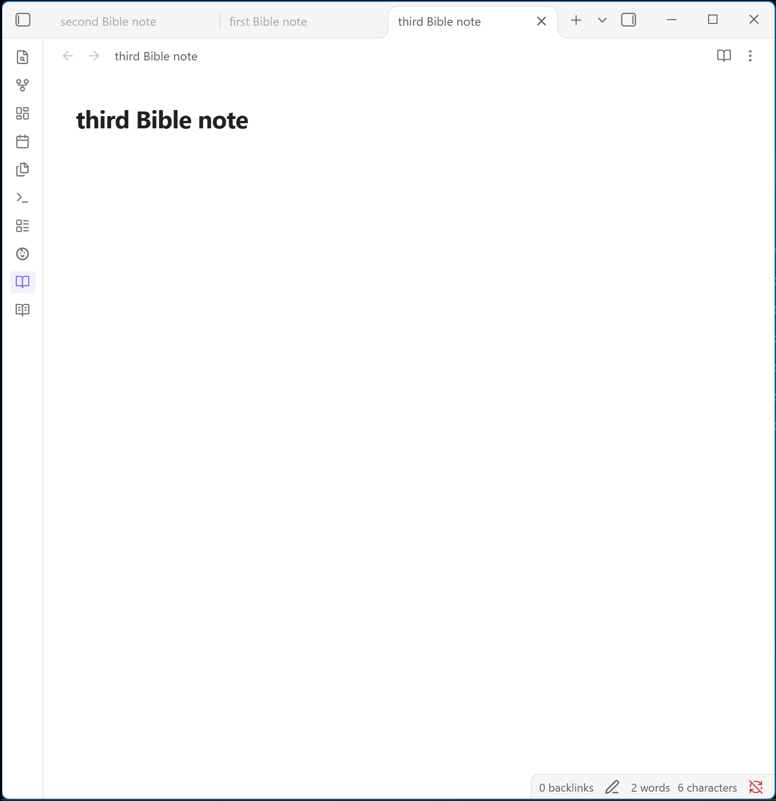
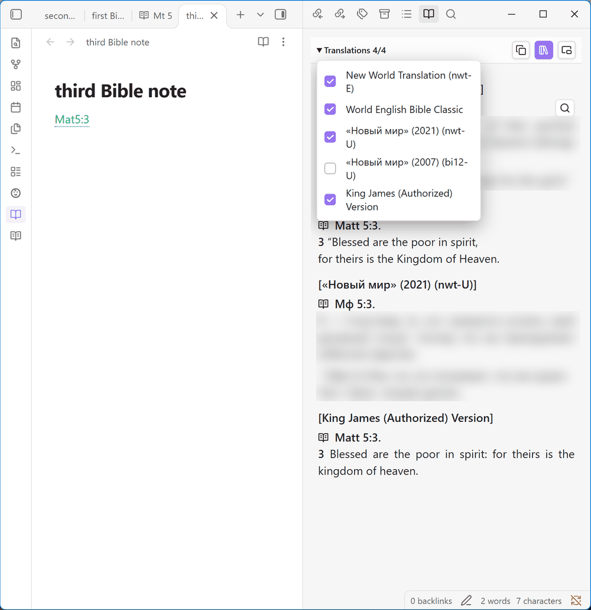
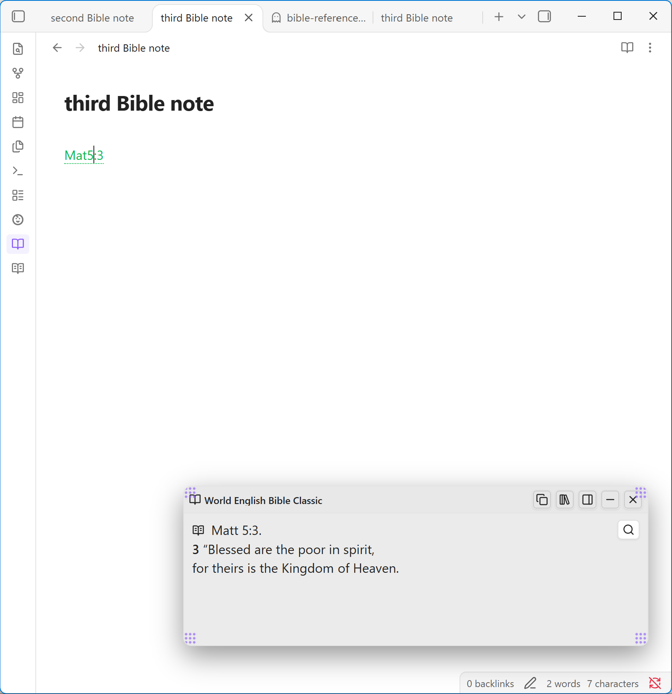
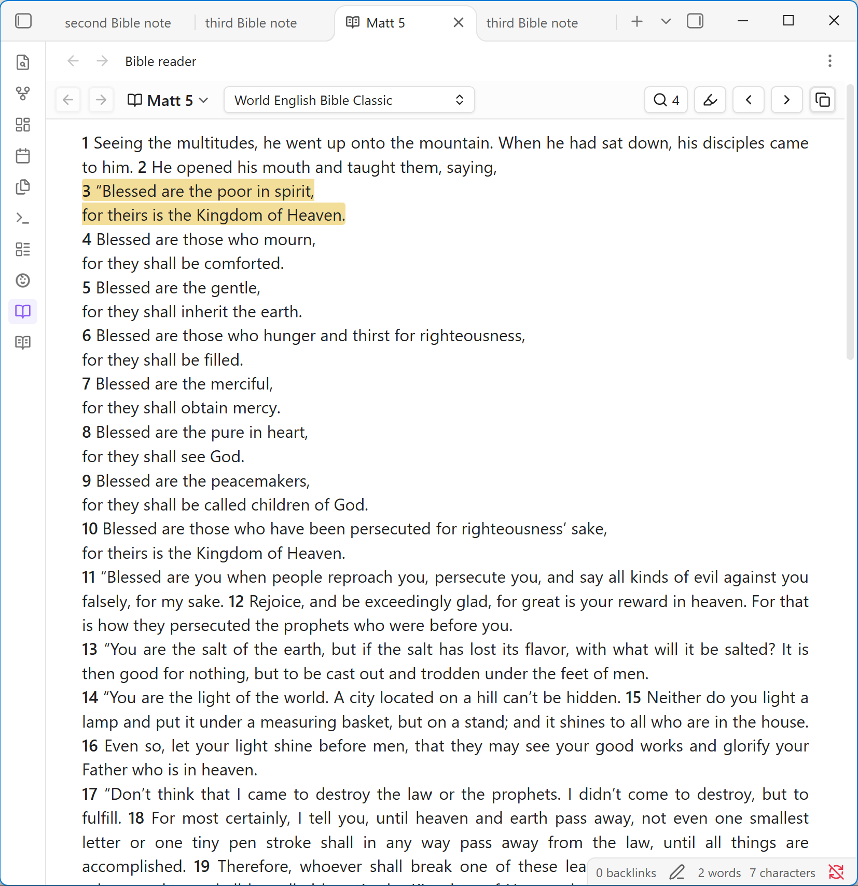
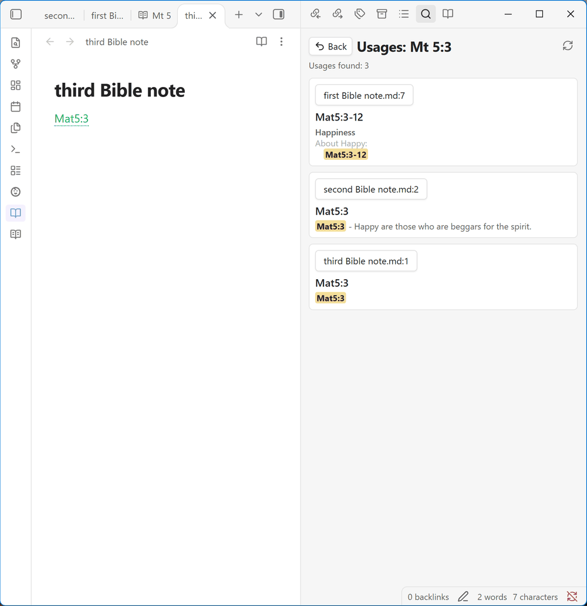
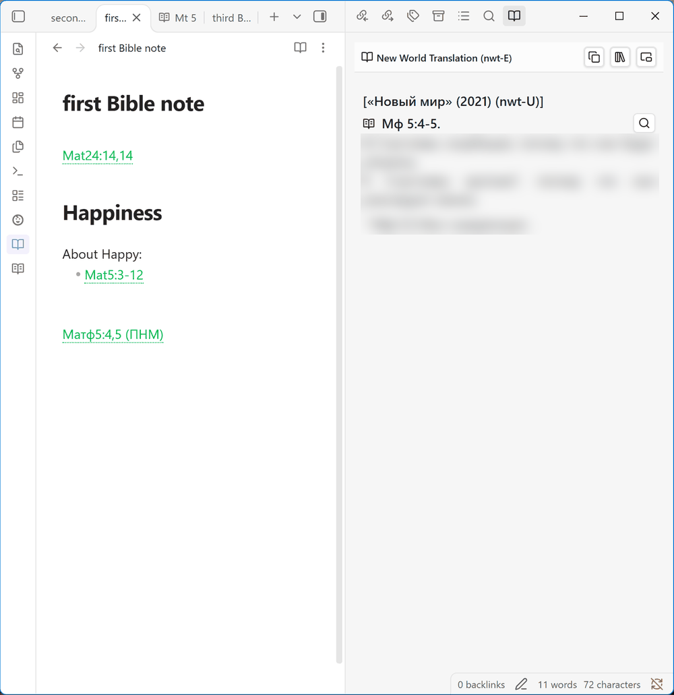
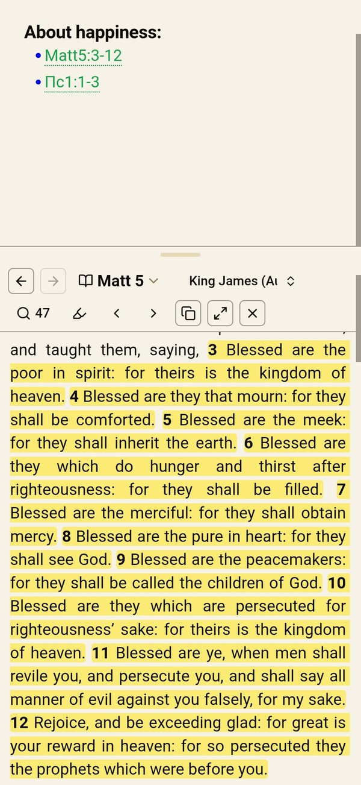
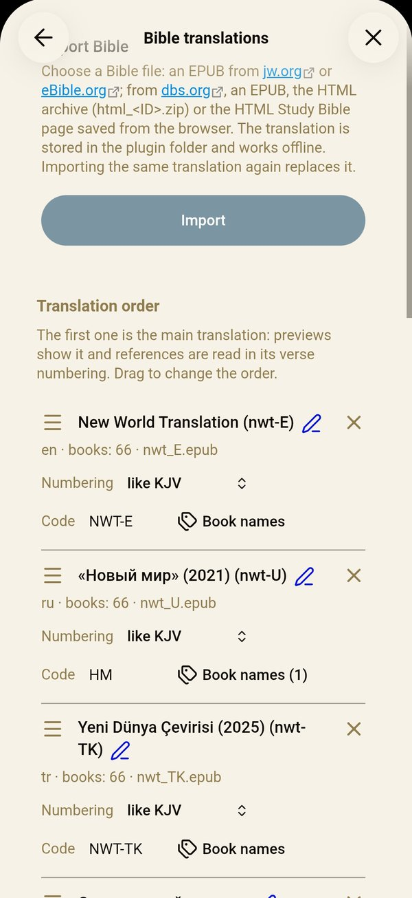

# Bible Reference Preview

[English](README.md) | **Русский**

[](https://boosty.to/yuriybak)

Напишите в заметке `Ин 3:16` и читайте стих прямо рядом с ней: во всплывающем окне или в боковой панели. Работает без интернета на компьютере и на телефоне (Android, iOS) с переводами Библии, которые вы один раз импортируете из бесплатных файлов EPUB и HTML, на любом языке, на котором они изданы.



## Почему этот плагин

- **Работает с уже написанными заметками.** Откройте любую заметку, и все библейские ссылки в ней подсветятся как ссылки, без особого синтаксиса, блоков кода или тегов. Ссылки подчёркнуты пунктиром и окрашены в выбранный вами цвет, поэтому их легко отличить от обычных ссылок.
- **Работает без интернета.** Переводы хранятся на вашем устройстве, плагин не делает сетевых запросов.
- **Ваши переводы.** Импорт Библий с jw.org, eBible.org (сотни переводов на многих языках) и Digital Bible Society (dbs.org).
- **Сравнение до четырёх переводов** рядом. Нумерация стихов пересчитывается между переводами: Синодальный Пс 22 в английской Библии показывается как Psalm 23.
- **Чтение Библии:** любая книга и глава, даже без ссылки в заметке, в любом импортированном переводе без смены перевода по умолчанию. Процитированные стихи подсвечены.
- **Поиск мест, где цитируется отрывок,** по всем заметкам, с коротким контекстом для каждого упоминания.
- **Компьютер и телефон:** Windows, macOS, Linux, Android и iOS. Интерфейс на русском и английском.

## Что нового в 0.3.4

- **Компактный список переводов:** строки на странице **Переводы Библии** стали короче, схемы нумерации названы по эталонной Библии (**как KJV**, **как Синодальный**…), в описании импорта есть ссылки на jw.org, eBible.org и dbs.org.
- **Чтение Библии на телефоне:** глава всегда открывается так, как выбрано в **Чтение Библии на телефоне**; перенос главы между вкладкой и панелью под заметкой меняет эту настройку.
- **Надёжнее и понятнее:** список переводов записывается с резервной копией, ошибки импорта показываются на языке интерфейса, большая страница dbs.org больше не забивает память.
- **Быстрее в больших хранилищах:** индекс использований сохраняется только при изменении ссылок, а цвет ссылок сразу меняется и в режиме чтения.

Все изменения, в том числе в бетах, которые ещё готовятся, — в [журнале изменений](CHANGELOG.md) (на английском).

## Скриншоты

<table>
<tr><td width="50%"><br><sub>Сравнение до четырёх переводов в боковой панели</sub></td><td width="50%"><br><sub>Плавающее окно</sub></td></tr>
<tr><td width="50%"><br><sub>Режим главы с подсвеченным стихом</sub></td><td width="50%"><br><sub>Где отрывок цитируется в заметках</sub></td></tr>
<tr><td width="50%"><br><sub>Код перевода после ссылки: (СП) показывает русский перевод</sub></td><td></td></tr>
<tr><td width="50%" align="center"><br><sub>На телефоне: чтение Библии под заметкой</sub></td><td width="50%" align="center"><br><sub>На телефоне: страница «Переводы Библии»</sub></td></tr>
</table>

## Быстрый старт

1. Установите **Bible Reference Preview** в Настройки → Сторонние плагины и включите его. Уведомление с кнопкой **Открыть настройки** подскажет, с чего начать; пока перевод не импортирован, на странице **Переводы Библии** в настройках плагина есть ссылки, где скачать файл Библии.
2. Скачайте бесплатный файл Библии (EPUB), например [Синодальный перевод](https://ebible.org/epub/russyn.epub). Другие переводы и языки — на [ebible.org/find](https://ebible.org/find/), английские: [World English Bible](https://ebible.org/epub/engwebp.epub), [King James Version](https://ebible.org/epub/eng-kjv2006.epub).
3. Откройте Настройки → Bible Reference Preview → **Переводы Библии**, нажмите **Импортировать**, выберите файл и снова нажмите **Импортировать**.
4. Напишите в любой заметке ссылку, например `Ин 3:16` или `Рим 8:28-30`. Превью откроется для абзаца под курсором.

Другие источники и подробности — в разделе [Импорт перевода](#импорт-перевода).

## Возможности

- **Ссылки** распознаются в любой заметке, новой или старой, в редакторе и в режиме чтения, и показываются как ссылки: `Ин3:16`, `Мк 4:12, 14-16`, `Иуд 1:3;1:5`, `Суд 7:24-8:1`, книги из одной главы (`Иуд 5` = `Иуд 1:5`). Названия книг и сокращения берутся из импортированных переводов, поэтому ссылки работают на языке любого из них (`Ин3:16` с русской Библией, `John 3:16` с английской, в одной заметке). Если в двух переводах одинаково сокращены разные книги, побеждает основной перевод; нумерация — по основному, если не указан код перевода. Свои названия и сокращения книг добавляются кнопкой **Названия книг** в строке перевода на странице **Переводы Библии** в настройках (`Йн`, `Jhn`): они распознаются так же, как родные названия перевода; название, которое уже есть у другой книги этого перевода, добавить нельзя. Библейские ссылки подчёркнуты пунктиром и по умолчанию зелёные, чтобы не путать их с обычными; цвет можно изменить в настройках.
- **Превью** открывается для ссылки в текущем абзаце или только по клику на ссылку. Всплывающее окно можно перетаскивать, менять его размер и сворачивать; боковая панель может быть слева или справа. Оба варианта работают в отдельных окнах Obsidian.
- **На телефоне** удобнее всего боковая панель: выберите **Режим показа текста Библии** → **Боковая панель**, и текст Библии будет открываться и закрываться свайпом от края экрана. Чтение Библии прокручивается как заметка: если в Obsidian включён **Полноэкранный режим**, нижняя панель прячется при чтении. Чтобы читать и писать одновременно, выберите **Чтение Библии на телефоне** → **Под заметкой**: глава откроется в панели под заметкой, высота меняется перетаскиванием полоски над ней. В меню ⋯ вкладки чтения есть пункт **Открыть под заметкой**, а в панели под заметкой есть кнопка открытия во вкладке; такой перенос меняет и настройку. Команда **Показать или скрыть чтение Библии под заметкой** открывает и закрывает панель.
- **Текст Библии** сохраняет абзацы, поэтические строки, сноски, надписания псалмов и стихи, которые перевод объединяет («16–17»).
- **Копирование** отрывка в Markdown в том же формате, что и **Вставка текста Библии** (ниже): вставленный вручную отрывок выглядит так же, как вставленный командой (при формате «блок bible» — выноской: в копии всегда есть текст); в том числе в режиме сравнения.
- **Вставка текста Библии** в заметку: поставьте курсор на ссылку и выполните команду **Вставить текст Библии** (отрывок встанет под абзацем) или выполните её в любом месте и введите ссылку. При наборе напишите `--` и название книги: подсказки предложат книги, а затем ссылку отдельно или с текстом в развёрнутой выноске, свёрнутой выноске или блоке `bible` (`--Ин 3:16`). Пункт **Вставить в заметку** в меню ⋯ превью (в плавающем окне: правый клик по его заголовку) вставляет показанный отрывок. Текст вставляется выноской (`> [!bible] Ин 3:16`), свёрнутой выноской (`> [!bible]- Ин 3:16`), цитатой или блоком `bible`, с номерами стихов и сносками или без: см. **Вставка текста Библии** в настройках, там же меняется или выключается `--`.
- **Текст Библии в заметке:** блок кода `bible` показывает текст ссылок, записанных в нём по одной в строке, из ваших переводов. В заметке остаются только ссылки, текст берётся из основного перевода (или из того, чей код указан после ссылки) и попадает в экспорт заметки в PDF и в печать. Obsidian Publish не запускает плагины, поэтому в опубликованной заметке будут только ссылки.

  ````
  ```bible
  Ин 3:16
  Рим 8:28-30
  ```
  ````
- **Чтение Библии:** значок открытой книги в заголовке отрывка открывает всю главу во вкладке чтения, в переводе и нумерации этого отрывка. Клик по названию главы открывает выбор книги и главы (введите `Ин`, `1 Кор 13` или `Ин 3:16` для фильтра); то же делает команда **Перейти к книге и главе Библии**. Список переводов показывает ту же главу в другом переводе (Синодальный Пс 22 → английский Ps 23), не меняя перевод по умолчанию. «Назад» и «вперёд» ходят по открытым главам, стрелки открывают предыдущую или следующую главу, маркер скрывает или показывает подсветку, значок кавычек показывает все места использования главы, лупа открывает поиск по Библии. Ctrl/Cmd-клик по значку на боковой ленте открывает ещё одну вкладку чтения; последняя глава открывается снова после перезапуска.
- **Сравнение:** включается кнопкой с книгами на полке в заголовке превью (пока сравнение включено, кнопка подсвечена); переводы выбираются в списке в заголовке.
- **Код перевода** после ссылки показывает отрывок в этом переводе и в его нумерации: `Пс 22:1 (СП)`, где `СП` — код импортированного перевода. Коды можно менять в списке переводов.
- **Поиск по Библии:** команда **Искать в Библии** или лупа в окне чтения открывает панель поиска стихов по словам: должны встретиться все слова, слово ищется по началу (`любов` найдёт «любовью»), фраза в кавычках ищется точно, как написана; регистр и ударения не важны. Выберите перевод и всю Библию, один из Заветов или одну книгу; результаты сгруппированы по книгам, клик открывает главу в окне чтения с подсвеченным стихом. Текст, набранный в выборе книги, тоже можно найти оттуда, даже если он совпадает с названием книги (Иов). Перевод читается в память при открытии панели или первом поиске; на диск ничего не записывается. На телефоне результат, открывший главу под заметкой, скрывает панель.
- **Индекс использований:** значок кавычек рядом с отрывком показывает заметки, которые его цитируют, с заголовком и строками, под которыми стоит ссылка. Открытые заметки учитываются вместе с несохранёнными правками. Индекс обновляется сам в фоне; исключённые папки и большие файлы пропускаются. Полное построение тоже идёт в фоне: уведомление показывает прогресс (его можно закрыть) и кнопку «Отмена», а поиск до конца построения работает по прежнему индексу.
- **Команды:** открыть ссылку под курсором (можно назначить сочетание клавиш), вставить текст Библии, искать в Библии, открыть чтение Библии или перейти к книге и главе, найти места использования, импортировать Библию, включить или выключить плагин, прокрутить превью. Горячие клавиши назначаются в Настройки → Горячие клавиши.
- **Настройки** находятся поиском по настройкам Obsidian. В них: режим и расположение превью, формат вставляемого текста, цвета ссылок и окна и страница **Переводы Библии**: импорт, порядок переводов (первый — основной; перетаскивайте за значок слева), название (карандаш рядом с ним), схема нумерации («как KJV», «как Синодальный» и т. д.), код перевода, названия книг, индекс Библии и индекс использований.

## Планы

Всё запланированное сделано. Есть идея? [Создайте issue](https://github.com/yuriy-bak/obsidian-bible-reference-preview/issues/new/choose) или поделитесь ей в [Discussions](https://github.com/yuriy-bak/obsidian-bible-reference-preview/discussions/categories/ideas).

[Все запланированные функции](https://github.com/yuriy-bak/obsidian-bible-reference-preview/issues?q=is%3Aissue+is%3Aopen+label%3Aroadmap) — ставьте 👍 тем, которые вам нужны.

## Установка

**Из каталога.** Установите **Bible Reference Preview** в Настройки → Сторонние плагины (Obsidian 1.13 или новее), на компьютере или на телефоне.

Переводы хранятся в папке плагина (`.obsidian/plugins/bible-reference-preview/data`), а не в заметках. Чтобы пользоваться переводом на другом устройстве, импортируйте файл и там или используйте синхронизацию, которая копирует папки плагинов.

**Бета-версии** публикуются как pre-release на GitHub. Устанавливаются через [BRAT](https://github.com/TfTHacker/obsidian42-brat):

1. Установите и включите **BRAT** из сторонних плагинов.
2. Выполните команду **BRAT: Add a beta plugin for testing**.
3. Введите `https://github.com/yuriy-bak/obsidian-bible-reference-preview` и выберите последнюю версию.

**Вручную:**

1. Скачайте `main.js`, `manifest.json` и `styles.css` из [релиза](https://github.com/yuriy-bak/obsidian-bible-reference-preview/releases).
2. Скопируйте их в папку `.obsidian/plugins/bible-reference-preview/` вашего хранилища.
3. Включите **Bible Reference Preview** в Настройки → Сторонние плагины.

## Импорт перевода

Откройте Настройки → Bible Reference Preview → **Переводы Библии** → **Импортировать** и выберите файл. Плагин сам определит формат. Проверьте название и язык перевода и нажмите **Импортировать**. Импорт идёт в фоне: прогресс и кнопка «Отмена» видны в уведомлении и в настройках, а с уже импортированными переводами можно работать дальше. Повторный импорт того же перевода заменяет его.

Где взять файл:

- **jw.org:** скачайте Библию (Перевод нового мира) в формате EPUB на странице публикаций.
- **eBible.org:** на [ebible.org/find](https://ebible.org/find/) откройте перевод и скачайте его **ePub**. Импортируются только 66 книг протестантского канона. Прямые ссылки на популярные переводы: [Синодальный](https://ebible.org/epub/russyn.epub), [World English Bible](https://ebible.org/epub/engwebp.epub), [King James Version](https://ebible.org/epub/eng-kjv2006.epub).
- **dbs.org:** см. ниже.

Схема нумерации стихов определяется по тексту. Если плагин не уверен, он попросит выбрать схему; позже её можно сменить в списке переводов.

### dbs.org (Digital Bible Society)

На [dbs.org/bibles](https://dbs.org/bibles) есть переводы, которых нет на eBible.org, например «Современный перевод» (RUSERV). Откройте страницу перевода и выберите первый из доступных вариантов:

1. **HTML** (`html_<ID>.zip`): лучший вариант, сохраняет абзацы и поэзию. Импортируйте архив как есть, распаковывать не нужно. В архиве нет названия перевода, впишите его в окне импорта.
2. **EPUB:** название перевода есть, но абзацев часто нет, и каждый стих показывается с новой строки.
3. **Только HTML Study Bible**, когда файла для скачивания нет (как у RUSERV). Сохраните страницу сами на компьютере:
   1. На странице перевода нажмите **HTML Study Bible**. Библия откроется в браузере (адрес `bibles.dbs.org/<ID>/app-json-study/index.html`). Дождитесь, пока появится текст.
   2. Нажмите **Ctrl+S** (**Cmd+S** на macOS).
   3. Выберите тип **Веб-страница, только HTML** и сохраните.
   4. Импортируйте сохранённый файл `.html`. Впишите название перевода в окне импорта: на странице есть только его короткий код, например `RUSERV`.

   В браузере на телефоне так сохранить страницу нельзя. Сделайте файл на компьютере, скопируйте на телефон и импортируйте там.

Стихи, которые перевод объединяет, показываются под одним номером («16–17»). В некоторых файлах dbs.org потеряны списки, например родословия (1 Пар 1–2, Мф 1:2–17, Рим 16:3–16); эти стихи показываются как отсутствующие. Плагин только читает файл и ничего никуда не передаёт; перед тем как делиться файлом, проверьте лицензию перевода.

## Тексты Библии и авторские права

Плагин не содержит текста Библии и ничего не скачивает: вы импортируете файл, который скачали сами, и текст хранится в папке плагина в вашем хранилище. Плагин не связан с jw.org, eBible.org и Digital Bible Society. У каждого перевода остаются его авторские права и условия сайта, откуда вы его взяли; например, jw.org разрешает использовать свои публикации в личных некоммерческих целях. Используйте импортированные тексты для личного изучения и проверяйте лицензию, прежде чем ими делиться.

## Конфиденциальность

Плагин не делает сетевых запросов. Список Markdown-файлов он читает только для локального индекса использований, а в буфер обмена пишет только по кнопке копирования.

## Обратная связь

Нашли ошибку, нераспознанную ссылку или файл Библии, который не импортируется? Есть идея? [Создайте issue](https://github.com/yuriy-bak/obsidian-bible-reference-preview/issues/new/choose): хватит пары слов, по-русски или по-английски. Вопросы, идеи и рассказы о том, как вы пользуетесь плагином, — в [Discussions](https://github.com/yuriy-bak/obsidian-bible-reference-preview/discussions). Если идея уже есть в [планах](#планы), поставьте ей 👍. Если плагин вам полезен, звезда на GitHub поможет другим его найти, а поддержать разработку можно на [Boosty](https://boosty.to/yuriybak).

## Разработка

```bash
npm run lint
npm test
npm run build
```

Скрипты сборки, тесты, релизы и устройство импорта описаны в [CONTRIBUTING.md](CONTRIBUTING.md) (на английском), история изменений — в [CHANGELOG.md](CHANGELOG.md).

## Лицензия

MIT. См. [LICENSE](LICENSE). Сторонние данные: [THIRD_PARTY_NOTICES.md](THIRD_PARTY_NOTICES.md).
